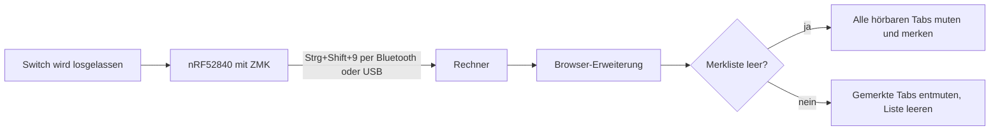

# Mute-Buzzer – Briefing für die Projekt-Website

Dieses Dokument ist die vollständige Vorlage, um eine Website über dieses Projekt zu bauen. Es enthält Auftrag,
Seitenaufbau, fertige Texte, geprüfte Fakten und die Download-Links.

Stand: 01.11.2026.

---

## 1. Auftrag

**Baue eine einseitige, öffentlich hostbare Projektseite (One-Pager) auf Deutsch.**

- **Zweck:** Das Projekt zeigen und erklären und die Browser-Erweiterung zum Download anbieten, nicht verkaufen. Es gibt
  kein Produkt, keinen Shop und keine Warteliste.
- **Zielgruppe:** Technikinteressierte, Maker, 3D-Druck- und Tastatur-Leute. Die obersten Abschnitte müssen auch
  ohne Technikwissen verständlich sein, nach unten wird es technischer.
- **Tonfall:** Sachlich, trocken, mit Freude am Basteln. Keine Werbesprache, keine Superlative.
- **Das Herzstück ist die interaktive Demo** (Abschnitt 5): Besucher drücken einen großen roten Knopf und sehen,
  was mit den Tabs passiert.
- **Ehrlichkeit vor Wirkung:** Das Gehäuse ist noch nicht gedruckt, und es gibt noch keine Fotos. Die Seite sagt das
  offen (Abschnitt 7). Renderings werden als Rendering beschriftet.

---

## 2. Das Projekt in Kürze

**Name:** Mute-Buzzer

**Ein Satz:** Ein großer, runder 3D-gedruckter Knopf, der per Bluetooth am Rechner hängt und mit einem Schlag alle
Browser-Tabs stummschaltet, die gerade Ton abspielen. Der nächste Schlag macht genau diese Tabs wieder laut.

**Art des Projekts:** Ein Einzelstück und privates Bastelprojekt.

**Die drei Bausteine:**

1. **Hardware:** nRF52840-Board, ein mechanischer Tastatur-Switch, LiPo-Akku, Schiebeschalter und Reset-Taster.
2. **Firmware:** ZMK (Open-Source-Tastatur-Firmware). Für den Rechner ist der Knopf eine Tastatur mit einer einzigen Taste.
3. **Browser-Erweiterung:** Für Chrome/Edge und Firefox. Sie empfängt das Tastenkürzel und schaltet die Tabs.

**Der Kniff:** Der Knopf weiß nichts von Tabs. Er sendet nur `Strg+Shift+9`. Die Intelligenz sitzt in der Erweiterung,
und deshalb braucht der Rechner keinen eigenen Treiber und keine zusätzliche App.

---

## 3. Seitenaufbau und Texte

Die Texte sind fertige Vorschläge und dürfen sprachlich geglättet werden. Die Fakten dürfen sich dabei nicht ändern.

### 3.1 Hero

- **Überschrift:** Ein Knopf. Alle Tabs still.
- **Unterzeile:** Der Mute-Buzzer ist ein großer Bluetooth-Knopf aus dem 3D-Drucker. Einmal drücken: Alle Tabs, die
  gerade Ton machen, sind stumm. Nochmal drücken: Genau diese Tabs sind wieder laut.
- **Hinweiszeile:** Einzelstück und Bastelprojekt, kein Produkt.
- **Buttons:** „Erweiterung herunterladen“ (springt zu Abschnitt 3.11) und „Auf GitHub ansehen“.
- **Bild:** Das 3D-Modell (Abschnitt 6) oder direkt die Demo.

### 3.2 Demo

Die interaktive Demo aus Abschnitt 5, mit dem Text: „Probier es aus. Das hier ist eine Simulation, hier wird kein
echter Tab stummgeschaltet.“

### 3.3 Was er macht

| Aktion | Ergebnis |
|---|---|
| Kurz drücken | Alle Tabs, die gerade Ton abspielen, werden stumm |
| Nochmal kurz drücken | Genau diese Tabs werden wieder laut |
| 5 Sekunden halten | Bluetooth-Kopplung wird gelöscht, zum Umziehen auf einen anderen Rechner |
| 2 Stunden nichts tun | Tiefschlaf. Der Druck, der ihn weckt, wird nicht als Mute gesendet |

Drei Details, die im Alltag zählen:

- Tabs, die du von Hand stummgeschaltet hast, bleiben stumm. Der Knopf merkt sich nur seine eigenen.
- Webseiten lassen sich nach Belieben auf eine Whitelist setzen. Sie werden nie stummgeschaltet.
- Ein rotes „AUS“ am Erweiterungs-Icon zeigt, dass gerade gemutet ist. Ein Klick aufs Icon macht dasselbe wie der Knopf.

### 3.4 So funktioniert es



Text: Der Knopf meldet sich am Rechner als ganz normale Bluetooth-Tastatur namens „Mute-Buzzer“. Beim Loslassen sendet
er `Strg+Shift+9`. Die Erweiterung lauscht auf dieses Kürzel, unter Windows in Chrome auch dann, wenn der Browser im
Hintergrund liegt. Steckt ein USB-Kabel, läuft alles über USB statt über Bluetooth.

### 3.5 Innenleben (Hardware)

| Teil | Details |
|---|---|
| Board | Pro Micro nRF52840, ein günstiger nice!nano-v2-Klon im SuperMini-Layout |
| Taste | Ein MX-kompatibler Tastatur-Switch |
| Akku | LiPo 3,7 V, 300 mAh, 30 × 20 × 6 mm, mit Schutzschaltung, JST-PH-2.0-Stecker |
| Ein/Aus | Schiebeschalter in der Plus-Leitung des Akkus |
| Reset | 6 × 6 mm Taster, von unten per Büroklammer erreichbar. Doppelklick öffnet den Bootloader |
| Laden und Flashen | USB-C. Die Firmware wird per Drag-and-drop als `.uf2` aufgespielt |

Verdrahtung, als kleines Schema darstellen:

```
Switch            P0.17 und GND (interner Pull-up, keine Widerstände oder Dioden)
Reset-Taster      RST und GND
Akku Plus         Schiebeschalter, dann B+
Akku Minus        B−
```

Gut zu wissen: Laden geht nur mit dem Schalter auf EIN, weil er auch die Ladeleitung trennt.

### 3.6 Gehäuse

Komplett im Code modelliert, mit CadQuery (Python). Das Skript ist die Quelle aller STL- und STEP-Dateien. Gedruckt
werden soll auf einem Bambu Lab A1 mit AMS.

- **Gehäuse:** Ø 80 mm, 18 mm hoch. Schienen für das Board, Akkufach, Öffnung für USB-C, Schlitz für den
  Schiebeschalter, Reset-Loch im Boden, vier Mulden für Gummifüße.
- **Deckel:** Steckdeckel mit Ausschnitt für den Switch (14,1 mm, Plattenstärke 1,5 mm) und Führungsring für die Kappe.
- **Kappe:** Ø 50 mm, mit eingeprägtem Mute-Symbol. Die Oberseite ist flach, damit sie kopfüber ohne Stützstruktur
  druckbar ist. Das Symbol kann per AMS andersfarbig gedruckt werden.
- **Gesamthöhe zusammengebaut:** rund 33 mm.

### 3.7 Firmware und Erweiterung (für Technik-Leute)

**Firmware**

- ZMK v0.3 (Zephyr 3.5), Board `nice_nano_v2`, eigenes Shield `mute_buzzer` mit `kscan-gpio-direct` an P0.17.
- Die Taste ist ein Hold-Tap (`tap-preferred`, 5000 ms): Tippen sendet `LC(LS(N9))`, Halten löst `BT_CLR` aus. Deshalb
  wird das Kürzel erst beim Loslassen gesendet.
- Automatischer Build über GitHub Actions.

**Erweiterung (Manifest V3, Rechte: `tabs` und `storage`)**

- `storage.session` hält die Liste der gemuteten Tab-IDs.
- Wird ein Tab geschlossen oder von Hand entmutet, fliegt er aus der Liste.
- Die Whitelist ist die Konstante `EXCLUDED_URLS`. Ein Tab ist ausgenommen, wenn seine URL mit einem der Einträge beginnt.
- Ist die Liste leer und spielt nichts, entmutet sie alle Tabs, die sie laut `mutedInfo.extensionId` selbst
  stummgeschaltet hat. Das fängt den Fall ab, dass die Liste verloren ging, etwa durch einen Browser-Neustart.
- Chrome und Firefox teilen sich dasselbe `background.js`, nur die Manifeste unterscheiden sich.

| Browser und System | Reagiert der Knopf im Hintergrund? | Warum |
|---|---|---|
| Chrome/Edge unter Windows | Ja | Eigener Befehl `toggle-mute` mit `"global": true` |
| Chrome auf dem Mac | Nein, nur im Vordergrund | Globale Kürzel verlangen dort Cmd, der Knopf sendet Ctrl |
| Firefox | Nein, nur im Vordergrund | Firefox kennt keine globalen Kürzel |

Gute Code-Beispiele: `3-Firmware-Quellcode-ZMK/config/mute_buzzer.keymap`, `mute_buzzer.conf` und die Funktion
`toggle()` aus `background.js`.

### 3.8 Was beim Bauen schiefging

Der interessanteste Teil der Seite. Als Karten oder kleine Geschichten darstellen.

1. **Das Board ohne Uhr.** Das Klon-Board hat keinen 32,768-kHz-Quarz. Mit der Standardeinstellung für den nice!nano
   startet USB zwar, aber die Kernel-Timer laufen nicht, und es werden keine Tasten erkannt. Zur Eingrenzung entstand
   eine Diagnose-Firmware, bei der jeder Pin einen eigenen Buchstaben tippt. Die Lösung war eine einzige Zeile:
   `CONFIG_CLOCK_CONTROL_NRF_K32SRC_RC=y`. Das schaltet auf den internen RC-Oszillator um, und Bluetooth läuft damit
   ebenfalls.
2. **Plus und Minus vertauscht.** B+ und B− waren einmal verpolt angelötet. Das Board hat überlebt, vermutlich hat die
   Schutzschaltung des Akkus abgeschaltet. Danach wurde alles noch einmal komplett getestet.
3. **Chrome und seine Kürzel.** Auf dem Standardbefehl `_execute_action` bietet Chrome „Global“ gar nicht an. Die
   Kombination aus `"global": true` und `MacCtrl` verwirft Chrome kommentarlos. Und fehlt einem `suggested_key` sowohl
   die aktuelle Plattform als auch `default`, lehnt Chrome das ganze Manifest ab. Das Ergebnis sind zwei Befehle:
   `toggle-mute` für Windows, `_execute_action` für den Mac.
4. **Der PC, der nichts hörte.** Windows erkannte den Knopf als Tastatur, das Debug-Log zeigte fehlerfreies Senden, aber
   es kam nichts an. Am MacBook lief dieselbe Firmware per USB. Wahrscheinliche Ursache ist der Filtertreiber
   Interception, der nur 10 Tastatur-Plätze hat und beim Abstecken keinen freigibt. Nach einem Neustart kamen bei 133
   Drücken alle 798 Ereignisse an (6 pro Druck: drei Tasten runter, drei hoch). **Immer dazuschreiben:** Das ist die
   wahrscheinliche Ursache, nicht bewiesen, denn der Ausfall wurde nicht gezielt wiederholt.
5. **Netzteile, die einschlafen.** Manche USB-Netzteile und Powerbanks schalten bei dem geringen Strom einfach ab. Das
   Board ist dann aus und taucht nicht in der Bluetooth-Liste auf.

### 3.9 Stand

Die Tabelle aus Abschnitt 7 als ehrliche Statusanzeige.

### 3.10 Grenzen

- Stummgeschaltet werden nur Tabs in dem Browser, in dem die Erweiterung läuft. Desktop-Apps und andere Browser bleiben laut.
- Die Erweiterung steht in keinem Store. Sie wird in Chrome/Edge als entpackte Erweiterung im Entwicklermodus geladen.
  Für Firefox wäre eine dauerhafte Installation erst nach einer Signierung auf AMO möglich.
- Die Whitelist wird im Code der Erweiterung gepflegt, eine Einstellungsseite gibt es nicht.
- Der Knopf gibt keine Rückmeldung, ob gerade gemutet ist. Die LEDs nutzt die Firmware nicht, den Zustand zeigt nur das
  Icon im Browser.

### 3.11 Download

Text: Die Erweiterung gibt es kostenlos zum Herunterladen. Sie funktioniert auch ohne Knopf, per Klick aufs Icon oder mit
`Strg+Shift+9`.

| Button | Link |
|---|---|
| Chrome/Edge (ZIP) | https://github.com/marvinty/mute-buzzer/releases/latest/download/mute-buzzer-chrome.zip |
| Firefox (ZIP) | https://github.com/marvinty/mute-buzzer/releases/latest/download/mute-buzzer-firefox.zip |
| Quellcode auf GitHub | https://github.com/marvinty/mute-buzzer |

**Installation in Chrome/Edge:**

1. ZIP entpacken und den Ordner an einem festen Ort ablegen.
2. `chrome://extensions` beziehungsweise `edge://extensions` öffnen und den Entwicklermodus einschalten.
3. „Entpackte Erweiterung laden“ wählen und den Ordner angeben.

**Installation in Firefox:**

1. ZIP entpacken.
2. `about:debugging` öffnen, dann „Dieser Firefox“ und „Temporäres Add-on laden“ wählen.
3. Die `manifest.json` aus dem Ordner auswählen.

Immer dazuschreiben: In Firefox hält das nur bis zum nächsten Neustart des Browsers, weil die Erweiterung nicht signiert ist.

**Whitelist:** Die Liste `EXCLUDED_URLS` in `background.js` ist im Download leer. Dort lassen sich beliebige Seiten als
URL-Anfang eintragen, zum Beispiel `["https://example.com/"]`. Danach die Erweiterung neu laden.

### 3.12 Fußzeile

„Ein Bastelprojekt.“ Dazu der Link zum GitHub-Repo. Keine Kontaktdaten.

---

## 4. Gestaltung

- **Leitmotiv:** Großer runder roter Knopf mit weißem Lautsprecher-und-X-Symbol, wie im Icon.
- **Akzentfarbe:** `#d32f2f`, das Rot des „AUS“-Badges aus `background.js`. Das Icon ist ebenfalls rot.
- **Wirkung:** Ruhig und reduziert. Viel Weißraum, damit der Knopf das Lauteste auf der Seite ist. Das passt zum Thema.
- **Technik:** Hell- und Dunkelmodus, mobil voll nutzbar, die Demo auch per Touch bedienbar. Tabellen und
  Mermaid-Diagramm dürfen als eigene Grafiken neu gestaltet werden.
- **Bewegung:** Der Knopf darf beim Drücken sichtbar einfedern (echter Hub: 4 mm). `prefers-reduced-motion` beachten.
- **Ton:** Die Demo spielt keinen echten Ton ab. Lautstärke-Balken oder Wellen an den Tabs reichen.

---

## 5. Interaktive Demo (genaue Spezifikation)

Rein clientseitig, ohne Backend und ohne Browser-Rechte. Eine Attrappe eines Browsers mit Tab-Leiste, daneben oder
darunter der große Knopf. Die Logik bildet `toggle()` aus `2-Browser-Erweiterung/mute-buzzer-chrome/background.js` 1:1 ab.

**Tabs zum Start** (fiktive Namen, keine echten Marken oder Firmen):

| Tab | spielt Ton | von Hand stumm | auf der Whitelist |
|---|---|---|---|
| Musik | ja | nein | nein |
| Video | ja | nein | nein |
| Whitelist-Seite | ja | nein | ja, bleibt immer laut |
| Podcast | ja | ja | nein |
| Artikel | nein | nein | nein |

**Regeln:**

1. **Knopf gedrückt, Merkliste nicht leer:** Liste leeren und genau die gemerkten Tabs entmuten. Fertig.
2. **Knopf gedrückt, Merkliste leer:** Alle Tabs, die Ton spielen, nicht stumm sind und nicht auf der Whitelist stehen,
   werden stumm und kommen auf die Merkliste.
3. **Badge:** „AUS“ in `#d32f2f`, solange die Liste nicht leer ist.
4. **Von Hand entmuten** (Klick auf das Lautsprecher-Symbol eines Tabs): Der Tab fliegt aus der Liste. Wird die Liste
   dadurch leer, verschwindet das Badge.
5. **Tab schließen:** Der Tab fliegt ebenfalls aus der Liste.
6. **Auslösen beim Loslassen, nicht beim Herunterdrücken.** Wird der Knopf 5 Sekunden gehalten, passiert kein Mute,
   sondern eine Meldung erscheint: „Bluetooth-Kopplung gelöscht“ (simuliert).

**Das soll man ausprobieren können:**

- Der von Hand stumme Podcast bleibt auch nach dem zweiten Druck stumm.
- Die Whitelist-Seite bleibt die ganze Zeit laut.
- Wird während des Mutes ein neuer Tab laut (Button „Ton starten“ am Artikel), bleibt er beim Entmuten unberührt und
  spielt weiter. Erst der nächste Druck schaltet ihn stumm.

---

## 6. Dateien für die Seite

Bilder und 3D-Modelle beim Bauen **in die Website kopieren**, damit die Seite nicht von GitHub-Dateilinks abhängt.
Nur die Downloads aus Abschnitt 3.11 und das Repo werden direkt auf GitHub verlinkt.

| Datei | Verwendung |
|---|---|
| `2-Browser-Erweiterung/mute-buzzer-chrome/icons/icon128.png` | Logo und Favicon (roter Kreis mit Mute-Symbol, 128 px, klein oder als SVG nachzeichnen) |
| `4-Gehaeuse/kappe.stl`, `deckel.stl`, `gehaeuse.stl` | Interaktiver 3D-Viewer, zum Beispiel mit three.js und STLLoader |
| `4-Gehaeuse/vorschau.png` | CAD-Rendering mit vier Ansichten, darunter ein Schnitt mit eingezeichnetem Switch. Der Schnitt unten rechts eignet sich am besten, zum Zuschneiden |
| `4-Gehaeuse/quelle/mute_buzzer_case.py` | Referenz für Maße. Darf als Code-Beispiel gezeigt werden |

**3D-Viewer:** Alle drei STL liegen im selben Koordinatensystem (Millimeter, Z zeigt nach oben) und passen ohne
Verschieben zusammen. Eine Explosionsansicht entlang Z (Gehäuse, Deckel, Kappe) zeigt den Aufbau gut. In der Vorschau
ist die Kappe rot und der Rest grau, die echten Druckfarben stehen noch nicht fest. Beschriftung: „CAD-Modell, noch
nicht gedruckt“.

**Fotos:** Es gibt noch keine im Repo. Keine Fotos erfinden oder per KI generieren, die wie echte Aufnahmen des Knopfs
aussehen. Stattdessen den Viewer verwenden und die Seite so bauen, dass Fotos später leicht ergänzt werden können.

---

## 7. Aktueller Stand (nur das behaupten)

| Bereich | Status |
|---|---|
| Elektronik | ✅ Fertig gelötet und getestet |
| Firmware | ✅ Fertig, läuft per USB und Bluetooth |
| Browser-Erweiterung | ✅ Fertig (v1.0.4) |
| Gehäuse | 🟡 Dateien fertig, noch nicht gedruckt und nicht anprobiert |

**Getestet:**

- MacBook per Bluetooth: Koppeln, Muten und Entmuten, Entkoppeln und Neukoppeln, Akkubetrieb, Laden, Reset (Erweiterung v1.0.1).
- Windows in Chrome per USB mit v1.0.3: im Vordergrund und im Hintergrund, inklusive Whitelist.
- Chromium per Playwright: Logik, Badge und automatisches Setzen des Kürzels.
- Firefox: Nur `web-ext lint` ohne Fehler. Ein Knopftest ist nicht dokumentiert.

**Noch nicht getestet:** v1.0.3 und v1.0.4 auf dem Mac, v1.0.4 mit dem Knopf unter Windows, Edge unter Windows, der Knopf per Bluetooth unter Windows, alle Passungen
des Gehäuses.

**Nicht behaupten, weil nicht gemessen oder nicht belegt:** Akkulaufzeit, Bluetooth-Reichweite, Latenz, Kosten, Bauzeit
und dass das Gehäuse passt. Den Satz „funktioniert kabellos unter Windows“ erst nach einem Test verwenden. Auch eine
Geschichte darüber, warum der Knopf gebaut wurde, ist hier nicht belegt und wird nicht erfunden.

---

## 8. Nicht auf die Seite

1. **Persönliches:** Keine Namen von Personen, keine Kontaktdaten und keine Aussage darüber, für wen oder warum der Knopf
   gebaut wurde.
2. **Konkrete Whitelist-Einträge:** Die Whitelist wird nur als allgemeine Funktion beschrieben. In Beispielen steht
   `https://example.com/`, keine echte Seite und keine Andeutung einer bestimmten Art von Dienst.

Zusätzlich die Seite nicht als Produkt aufmachen: keine Preise, kein „Jetzt bestellen“, keine erfundenen Stimmen oder Zahlen.

---

## 9. Offene Entscheidungen (Standardwert gilt, wenn nichts anderes gesagt wird)

| Frage | Standard |
|---|---|
| Autorenname auf der Seite? | Nein |
| Sprache | Nur Deutsch |
